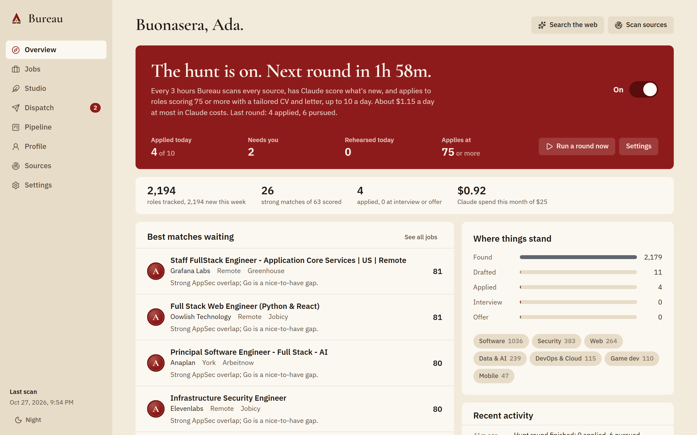

# Bureau — the job hunt atelier

A local-first, Claude-powered job hunter. Switch on **the hunt** and Bureau works on its own. It scouts the best tech roles (cybersecurity, web, mobile, game dev, data/AI, DevOps) across company career boards, remote-job aggregators and community hiring threads, and has Claude score each one against your CV. For every role above your bar it tailors your CV and cover letter and applies, either by email or by filling the company's own application form in a real browser. Every claim is fact-checked against your CV before anything goes out.



## Quick start (Windows)

1. Install [Node.js 22.13+](https://nodejs.org) (built and tested on Node 24).
2. Double-click **`Bureau.cmd`**. The first run installs dependencies and builds the UI, then opens `http://127.0.0.1:4317`.
3. In **Settings → Claude API key**, paste your key from [console.anthropic.com](https://console.anthropic.com).
4. In **Profile**, drop in your CV (PDF, DOCX, TXT or Markdown), check your phone number, and fill in **Application answers** (work authorisation, notice period, salary expectation). Forms ask for these every time.
5. On the **Overview**, flip **The hunt** on. Start in **Rehearsal** mode (Settings → The hunt): it fills every form but doesn't submit, and keeps a screenshot so you can check its work. Switch to **Live** when you're happy.

Google Chrome or Microsoft Edge must be installed for form applications. Bureau drives the browser you already have.

The hunt only runs while Bureau is running. To keep it going without a window, switch on **Settings → Start with Windows**. Bureau then starts silently at sign-in and logs to `data/bureau.log`; open it any time at `http://127.0.0.1:4317`.

From a terminal instead:

```bash
npm install
```

```bash
npm start
```

For development with hot reload (API on :4317, UI on :5317):

```bash
npm run dev
```

## The hunt

While Bureau is open, every *N* hours (default 3) it runs a round:

1. **Scout** every source and add new tech roles.
2. **Assess** the most promising with Claude (default 40 per round).
3. **For each role at or above your bar** (default 75), best first, up to your daily cap (default 10):
   - Tailor a CV and cover letter.
   - **Fact lock**: if any claim isn't backed by your CV, Claude rewrites once without it. If it's still not clean, the role is held back for you.
   - **Apply**: by email from your inbox if the posting asks for that (and the address appears in the posting itself). Otherwise through the company's form: Greenhouse, Lever, Ashby, Workable and most others, including aggregator listings that link out to them. Claude answers each question from your profile and the tailored CV is uploaded.
4. Anything it can't finish honestly lands in **Dispatch → Needs you**: a CAPTCHA, a required question your profile can't answer, or a form it couldn't find. **Finish in browser** opens a visible window with everything filled in; you check it and press submit.

Bureau never solves CAPTCHAs and never guesses an answer it can't back up.

## Under the hood

| Step | What happens | Who |
|---|---|---|
| Scout | 16 sources: Greenhouse, Lever and Ashby company boards (90+ curated companies across security, game studios, AI and dev tools, fintech), Remotive, Remote OK, We Work Remotely, Himalayas, Working Nomads, Jobspresso, Larajobs, Jobicy, Arbeitnow, The Muse, HN "Who is hiring", Reddit hiring subs (RSS), game-dev boards, and optionally the SimplifyJobs new-grad list | code |
| Deep scan | Claude uses web search to find roles on career pages, niche boards and social posts (LinkedIn, X, Reddit, HN). Only URLs seen in real search results are kept | Claude |
| Capture | Paste a post from your LinkedIn feed, X, Discord or a newsletter, or use the bookmarklet in **Sources** | you + Claude |
| Gate | Free filters: is it tech, which discipline, dedupe by URL and company+title, freshness, deal-breakers | code |
| Pre-score | Skills overlap, title, location, recency, seniority. No tokens spent | code |
| Assess | Two-pass review: requirements from the posting alone, then each matched against your CV with proof. Scores dimensions, legitimacy and red flags | Claude |
| Score | Weighted in code (requirements .45, dimensions .35, pre-filter .20, plus hard caps), so it's repeatable | code |
| Tailor | Cover letter, outreach DM and tailored CV, in your voice | Claude |
| Fact lock | A code check (every figure and employer must be in your CV) plus an independent Claude auditor | code + Claude |
| Approve & dispatch | You edit and approve. Email applications go from your inbox with the PDF attached; forms and DMs get one-click copy | you |
| Track | Drag-and-drop pipeline from shortlist to offer | you |

### Why Bureau doesn't auto-submit to LinkedIn or Indeed

Logged-in automation on those sites breaks their terms and gets accounts banned. The best-known open-source auto-applier, AIHawk, had its LinkedIn features removed after exactly that. Bureau applies where no login is needed: employers' own hosted forms and email. Roles you find on LinkedIn can still be captured (paste the post) and applied to through the company's own page. See [docs/RESEARCH.md](docs/RESEARCH.md).

## Claude usage & cost

- **Job scoring runs on Claude Haiku 5.5** (high volume, roughly $0.001 per role). **Everything a hiring manager reads runs on Claude Opus 5.5**: tailoring, the fact-lock audit and form answers, roughly $0.34 per application. All requests use server-side refusal fallback. Any task can be switched in **Settings → Engines**.
- **Settings → The hunt** shows a live cost estimate for your settings. It starts from typical token counts and switches to your real averages after a few runs. At the defaults (every 3h, 40 roles assessed, up to 10 applications a day), running all day costs up to about $3.65/day; applications are most of it.
- The scoring rubric and your profile are prompt-cached across a scan.
- A monthly budget cap (default $25) pauses all Claude calls, and so the hunt, when reached. Spend is metered per task in Settings.

## Security

Bureau is built to run on your desktop and to be safe if it ever leaves it. Details in [docs/SECURITY.md](docs/SECURITY.md). In short: it listens on loopback only, uses Host/Origin allow-lists, an HttpOnly SameSite=Strict session with CSRF tokens, and a strict CSP. Secrets are encrypted at rest (AES-256-GCM, master key sealed with Windows DPAPI). Outbound fetches have an SSRF guard, job HTML is sanitised twice, and uploads are validated by magic bytes.

## Configuration (environment variables)

| Variable | Default | Purpose |
|---|---|---|
| `BUREAU_PORT` | `4317` | API + UI port |
| `BUREAU_HOST` | `127.0.0.1` | Bind address. Anything else requires a passphrase first |
| `BUREAU_DATA_DIR` | `./data` | Database, uploads, sealed master key |
| `BUREAU_ALLOWED_ORIGINS` | — | Extra origins when deployed, e.g. `https://bureau.example.com` |
| `BUREAU_COOKIE_SECURE` | — | Set to `1` behind HTTPS |
| `BUREAU_MASTER_KEY` | — | 32-byte base64 key for servers without DPAPI |
| `ANTHROPIC_API_KEY` | — | Optional alternative to storing the key in Settings |

## Project map

```
server/            Fastify API (TypeScript, run with tsx)
  security/        guard (session/CSRF/lock), vault, SSRF-safe fetch, sanitiser
  sources/         16 job-source connectors + curated company boards
  ai/              Claude client, prompts, profile, scoring, tailoring, scout
  services/        scanner, classifier, autopilot, mailer, CV PDF renderer
  routes/          REST endpoints
web/               React 19 + Vite UI ("Cream & Crimson" design system)
design/            Design book source + screenshots
docs/              Design book PDF, OSS research, verified source catalogue, security notes
scripts/selfcheck  Offline checks (npm run selfcheck): schemas, scoring, classifier, security guards,
                   hunt routing and costs, start-with-Windows, and the form filler driven in your
                   own Chrome/Edge against a local test form. No API key, no real job sites.
```

## Documents

- **[Bureau Design Book (PDF)](docs/Bureau-Design-Book.pdf)**: concept, insignia, colour, type, voice, components, screens, engine, security.
- [Research: the open-source job-hunt landscape](docs/RESEARCH.md)
- [Verified job sources & 140+ company board tokens](docs/SOURCES.md)
