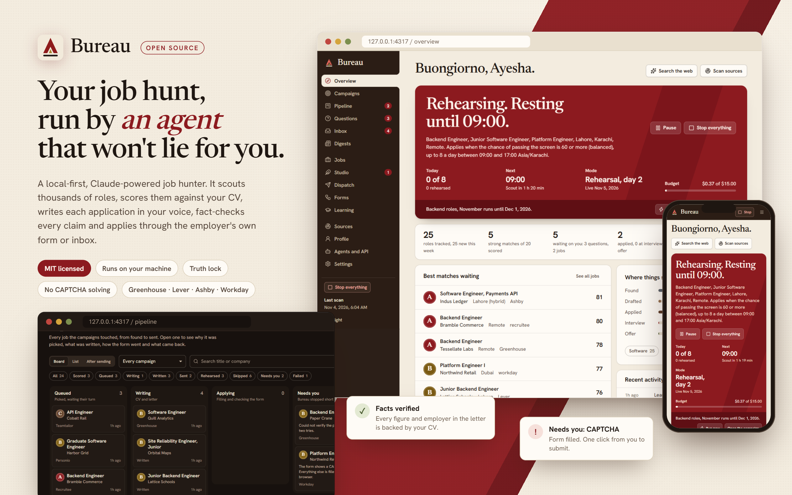
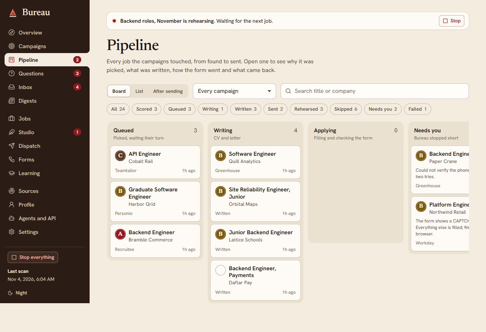
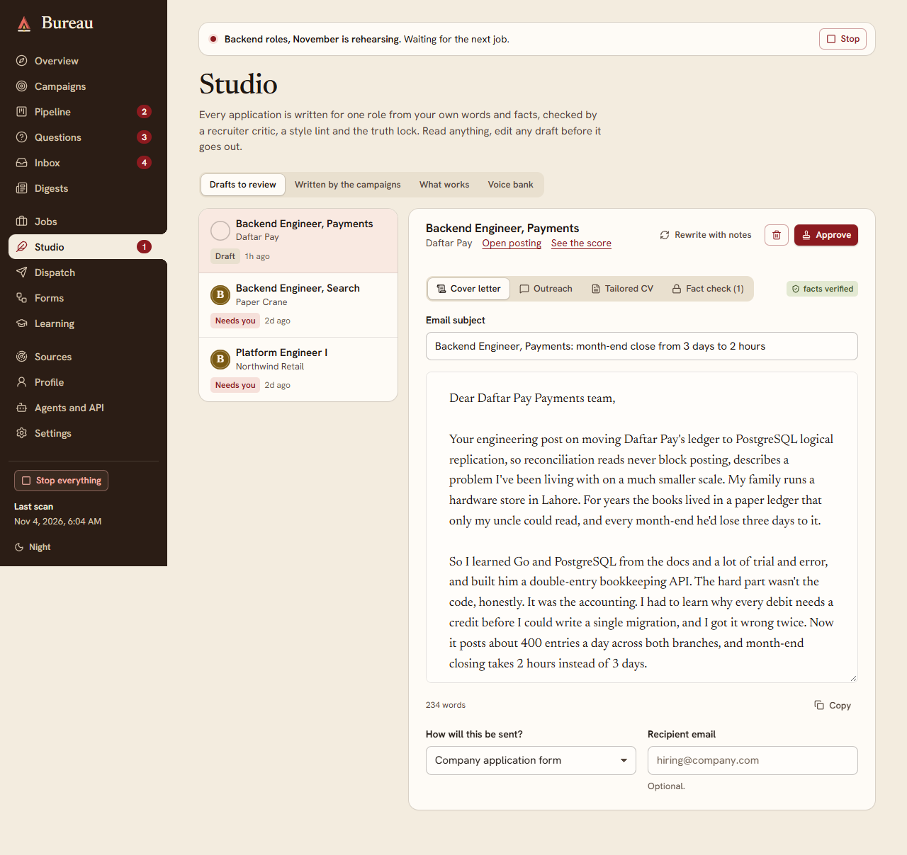
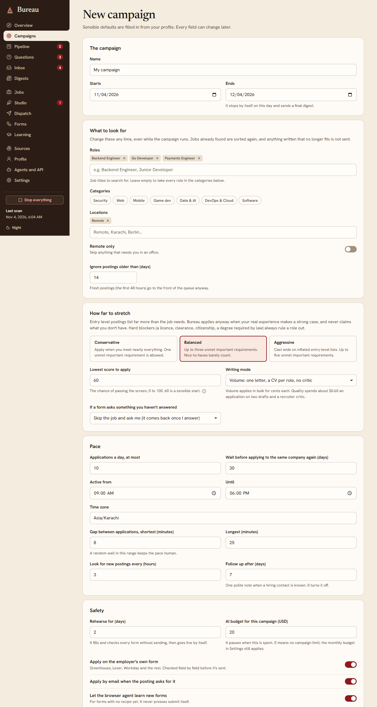
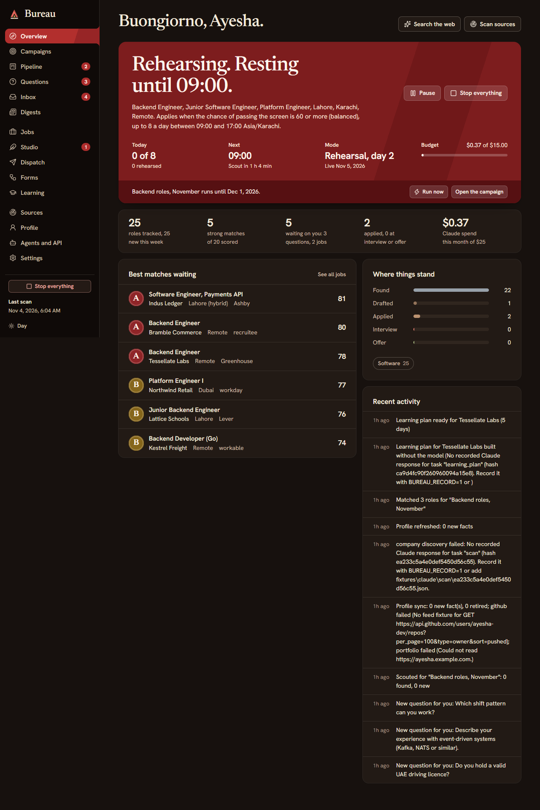

<div align="center">

# Bureau

**An open-source, local-first job-hunting agent, powered by Claude, that refuses to lie for you.**

[](LICENSE)




<sub>Every screen above shows demo data: a made-up candidate applying to made-up companies.</sub>

</div>

---

## What Bureau is

Looking for a first or second tech job is mostly repetitive work. You read hundreds of postings, decide which ones are worth it, rewrite the same cover letter forty ways, and type your name, email, phone number and work authorisation into a different form every time. The hard part, getting a person to read your application, gets the least of your time.

**Bureau does the repetitive work so you can spend your time on the interviews.** You set it up once with your CV, a few short passages in your own words and your standing answers to common form questions. Then you start a **campaign** ("remote backend roles in the US and Europe, at least $2,000 a month, up to 15 a day, $60 budget this month") and walk away. Until the campaign ends, Bureau:

1. **Scouts** every legitimate source it can reach: company career boards on Greenhouse, Lever, Ashby, Workday, SmartRecruiters, Workable, Recruitee, Personio, Teamtailor and more, remote-job aggregators, Hacker News and Reddit hiring threads, local boards, and Claude-driven web search. It reads tens of thousands of postings a round and keeps a company registry that grows by itself.
2. **Filters** for free, in code: wrong field, wrong country, "remote" that is really one country only, hybrid jobs dressed up as remote, pay below your floor, postings in a language you don't speak, senior titles when you're entry level, stale or closed postings, job seekers' posts mistaken for jobs, and companies you've applied to recently.
3. **Assesses** what's left with Claude. The score means *"how likely you are to pass the screen"*, not *"ticks every box"*. Entry-level postings ask for far more than the job needs, so Bureau applies to honest stretch roles too, while true blockers (a legally required licence, a clearance, citizenship) cap the score.
4. **Checks before it spends.** Before it writes a word it confirms the posting is still open, isn't behind a bot wall, isn't a board that only links out, and that the company isn't waiting on your answer to one of its questions.
5. **Writes** a tailored CV, a cover letter, an email subject line and the form's short answers for each job. It starts from *your own writing* (a voice bank of passages you wrote yourself), builds an evidence map from each requirement to the best true evidence in your CV, drafts several variants, has a recruiter-critic pick the best, and runs a style lint so it reads like a person wrote it.
6. **Fact-checks everything** with the **truth lock**: a code check that every number, employer, tool and credential appears in your CV, plus an independent Claude auditor. A claim it can't back is rewritten out. If the letter still isn't clean, the job is held back and nothing is sent.
7. **Applies** by email when the posting asks for that, or through the employer's own application form in a real Chrome or Edge window: it detects the form type, fills every field (custom dropdowns, location typeaheads, phone-country pickers, repeating sections, multi-step wizards, Workday account creation), **reads every field back to verify it** and only then submits.
8. **Asks you when it can't be honest.** A required question your profile can't answer truthfully ("Will you require sponsorship?"), a CAPTCHA, or a promise like "no AI was used in this application" stops the job. The question goes to your **Questions** page. Answer once and Bureau reuses the answer on every later form and puts the waiting jobs back in the queue.
9. **Follows up and teaches.** It reads a dedicated job-search mailbox, matches replies to applications, moves them along your pipeline, and when an interview or assessment arrives it builds a day-by-day crash plan for the gaps that company cares about.

Everything happens on your own computer. Your CV, answers, letters and database never leave it, except for the calls Bureau makes to the Claude API with your own key and the applications you've told it to send.

## The line it never crosses

The whole strategy is to win the interview. A made-up skill gets caught at the technical screen or the background check, *after* the interview has been won, and wastes it. So Bureau is built around honesty, in code and not just in prompts:

- **No fabrication.** No skills, employers, numbers, degrees or credentials that aren't in your CV. Gaps are named honestly and framed as things you're learning.
- **No CAPTCHA solving** and no bot-wall evasion. Those jobs wait for you in **Dispatch → Needs you**, with the form already filled, so you press one button.
- **No logged-in automation on LinkedIn or Indeed.** It breaks their terms and gets accounts banned. Bureau applies where no login is needed: employers' own forms and email.
- **No promises on your behalf.** Attestations ("I wrote this without AI", "I confirm that…") are never ticked for you.
- **No double applications.** A pipeline state machine and a "may have been sent" mark make sure a job is never applied to twice, even after a crash.
- **A budget it obeys.** A monthly cap pauses every Claude call when it's reached, and a kill switch stops everything at once.

## Open source, for the developer community

Bureau is **free and open source under the [MIT licence](LICENSE)**. It was built to help developers, especially students and early-career engineers who send hundreds of applications to get one reply, spend less time on forms and more time building things and preparing for interviews.

Paid "auto-apply" services charge a monthly fee, send generic letters in bulk and often break the sites' rules. Bureau goes the other way: you run it yourself, you pay only for the Claude tokens you use (a few cents per application), you can read every line it writes before or after it goes out, and you can change anything you like.

Contributions are welcome, and these would help most:

- **Form adapters** for more application systems (iCIMS, Taleo, SuccessFactors, SmartRecruiters forms).
- **Sources**: more legitimate job feeds, especially local boards outside the US and Europe.
- **Fixtures**: saved copies of real application forms that make the offline tests stronger.
- **Translations** of the interface, and writer support for more languages.

Open an issue or a pull request. Please keep the line above: nothing that fabricates, solves CAPTCHAs or automates logged-in sessions on sites that forbid it.

## Screens

| | |
|---|---|
|  **Pipeline**: every job a campaign touched, from found to sent, and why. |  **Studio**: read and edit any letter, CV or answer, with its fact check. |
|  **Campaigns**: roles, places, pay floor, stretch level, daily cap, hours and budget. |  **Night mode**, and it works on a phone as an installable app. |

## Quick start (Windows)

1. Install [Node.js 22.13 or newer](https://nodejs.org) (built and tested on Node 24) and have Google Chrome or Microsoft Edge installed.
2. Double-click **`Bureau.cmd`**. The first run installs dependencies and builds the interface, then opens `http://127.0.0.1:4317`.
3. The welcome wizard asks for your **Claude API key** (from [console.anthropic.com](https://console.anthropic.com)), your **CV** (PDF, DOCX, TXT or Markdown), a few **voice passages** and your **standing answers** (work authorisation, notice period, salary expectation, links).
4. Create a **campaign**. Start it in **Rehearsal**: it does everything except press submit, and keeps a screenshot of each filled form so you can check its work. Switch to **Live** when you're happy.

From a terminal on any OS:

```bash
npm install
```

```bash
npm start
```

For development with hot reload (API on :4317, UI on :5317):

```bash
npm run dev
```

There's also a `Dockerfile` and `docker-compose.yml`; see [docs/DEPLOY.md](docs/DEPLOY.md).

## How it works

| Stage | What happens | Who |
|---|---|---|
| Scout | Company ATS feeds, aggregators, remote boards, HN and Reddit threads, local boards, Claude web search, manual capture or bookmarklet. Resolves each listing to the employer's own apply link and merges duplicates | code + Claude |
| Filter | Field, location and real remoteness, salary floor, language, seniority, freshness, legitimacy, company cooldown. No tokens spent | code |
| Assess | Requirements split into critical, important and nice, each matched against your CV with proof. The score is weighted in code, so it's repeatable | Claude Haiku + code |
| Pre-check | Posting still open (asked directly from Greenhouse, Lever, Ashby and Workday), no bot wall, not a link-out board, no open question for this company | code |
| Write | Evidence map, CV, three letter variants from your voice bank, recruiter-critic, humaniser, style lint | Claude Opus |
| Truth lock | A code check (every figure, employer and tool must be in your CV) plus an independent auditor | code + Claude Opus |
| Apply | Email from your inbox, or the employer's form: per-ATS adapters, learned recipes, then a guarded browser agent for forms it hasn't seen. Every field read back and verified before submit | code + Claude |
| Learn | Successful browser-agent runs become recipes after three matching runs, so one Workday form teaches every company on Workday | code + Claude Sonnet |
| Follow up | Inbox classification, stage updates, interview alerts, one polite follow-up, crash learning plans | Claude |
| Report | Daily digest of what was sent, skipped and why, what needs you, spend and top skill gaps | code |

**Cost.** Scoring runs on Claude Haiku (a fraction of a cent per job). Everything a hiring manager reads runs on Claude Opus, roughly $0.30–0.50 per application. Each task's model can be changed in **Settings → Engines**, and the campaign page shows a live cost estimate.

**Other agents can use it.** Bureau exposes a scoped REST API (`/api/v1`) and an **MCP server** (`npm run mcp`, or streamable HTTP) so Claude in Chrome or any browser agent can pull an application packet, ask Bureau how to answer a form question and report back. See [docs/AGENT_API.md](docs/AGENT_API.md).

## Security

Bureau is meant to run on your desktop and stays safe if it ever leaves it. Details in [docs/SECURITY.md](docs/SECURITY.md). In short: it listens on loopback only, checks Host and Origin, uses an HttpOnly SameSite=Strict session with CSRF tokens and a strict CSP. Secrets are encrypted at rest (AES-256-GCM, with the master key sealed by Windows DPAPI). Outbound fetches go through an SSRF guard, job HTML is sanitised twice, and uploads are checked by their magic bytes.

## Tests

Everything runs offline, with no API key and no real job sites:

```bash
npm run selfcheck
```

About 660 checks: schemas, filters, scoring, the writer's lint and truth lock, campaign state machine, inbox, security guards, and the form engine driven in your own Chrome or Edge against local copies of Greenhouse, Lever, Ashby and Workday forms.

```bash
npm run typecheck
```

```bash
npm run e2e -- --strict
```

```bash
npm run ui-smoke
```

## Configuration

| Variable | Default | Purpose |
|---|---|---|
| `BUREAU_PORT` | `4317` | API and UI port |
| `BUREAU_HOST` | `127.0.0.1` | Bind address. Anything else requires a passphrase first |
| `BUREAU_DATA_DIR` | `./data` | Database, uploads, sealed master key |
| `BUREAU_ALLOWED_ORIGINS` | none | Extra origins when deployed, e.g. `https://bureau.example.com` |
| `BUREAU_COOKIE_SECURE` | none | Set to `1` behind HTTPS |
| `BUREAU_MASTER_KEY` | none | 32-byte base64 key for servers without DPAPI |
| `ANTHROPIC_API_KEY` | none | Optional alternative to storing the key in Settings |

## Project map

```
server/              Fastify API in TypeScript (run with tsx), data in node:sqlite
  scout/  sources/   job sources, ATS detection, normalising, liveness checks
  match/             hard filters, Claude assessment, scoring, selection
  writer/            evidence map, CV and letter writing, critic, lint, truth lock
  forms/             form engine, per-ATS adapters, widget handlers, verifier
  agent/             guarded Claude browser agent and recipe learning
  campaign/          campaign engine, worker, journal, pacing, kill switch
  inbox/ learning/   reply classification, follow-ups, crash learning plans
  api/               external agent REST API and MCP server
  security/          session, CSRF, vault, SSRF-safe fetch, sanitiser
web/                 React 19 + Vite interface ("Cream & Crimson" design system), installable PWA
scripts/             offline self-check, end-to-end and UI smoke tests, fixture server
fixtures/            saved forms and recorded responses for the offline tests
sidecars/jobspy/     optional Python sidecar for aggregator guest search
design/  docs/       design book, screenshots, research, sources, security notes
```

## Documents

- [Bureau Design Book (PDF)](docs/Bureau-Design-Book.pdf): concept, insignia, colour, type, voice, components, screens.
- [Agent API and MCP server](docs/AGENT_API.md)
- [Research: the open-source job-hunt landscape](docs/RESEARCH.md)
- [Verified job sources and company board tokens](docs/SOURCES.md)
- [Security notes](docs/SECURITY.md) and [deployment](docs/DEPLOY.md)

## Licence

[MIT](LICENSE). Use it, change it, share it. If it helps you land a job, tell us about it in an issue. That's the best thanks there is.
